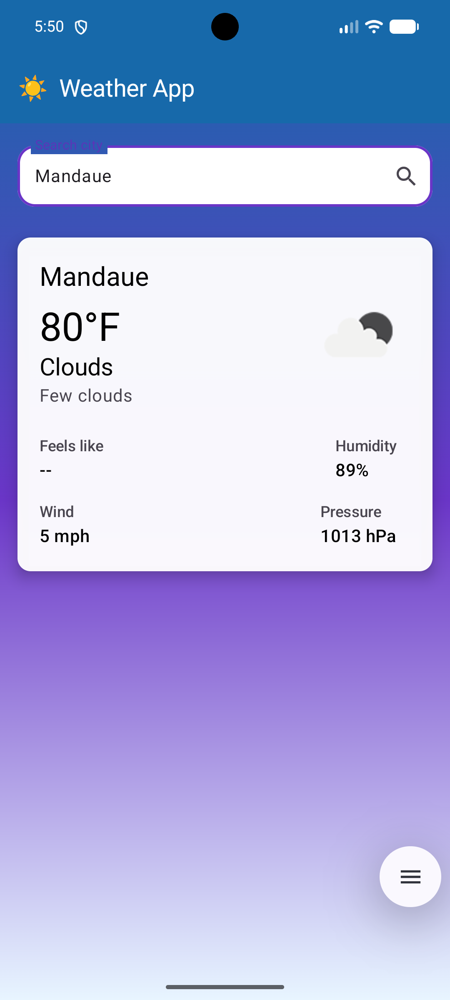
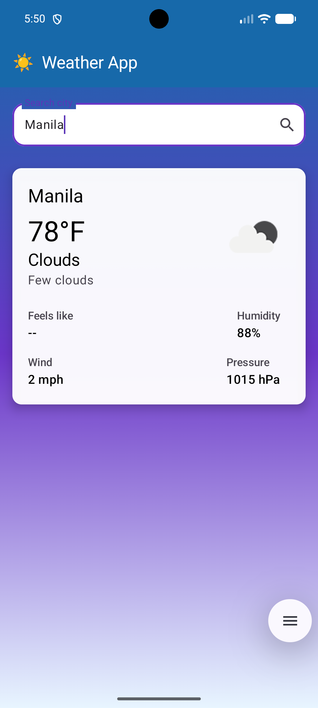

# WeatherApp

A Jetpack Compose weather app that searches for a city and displays its current weather using the OpenWeatherMap API.

## Screenshot




The screenshot was captured from the running Android emulator after launching the app.

## Features

- Search for current weather by city name
- Displays the city, temperature, weather condition, and description
- Shows the OpenWeatherMap weather icon
- Displays feels-like temperature, humidity, wind speed, and pressure
- Weather-responsive gradient backgrounds for sunny, cloudy, rainy, snowy, and stormy conditions
- Loading and error states
- Responsive content width for larger screens and tablets
- Search text preservation during configuration changes

## Technologies

- Kotlin
- Jetpack Compose
- Material 3
- Retrofit
- Moshi
- Glide
- OpenWeatherMap Current Weather API

## Setup

1. Open the project in Android Studio.
2. Obtain an API key from [OpenWeatherMap](https://openweathermap.org/api).
3. Add the key to the project's `local.properties` file:

   ```properties
   OPEN_WEATHER_API_KEY=your_api_key_here
   ```

   Do not commit this file or share the API key. `local.properties` is already excluded by `.gitignore`.

4. Sync the project with Gradle.
5. Run the app on an emulator or Android device.

## Build from the command line

From the project directory, run:

```powershell
.\gradlew.bat assembleDebug
```

The debug APK is generated at:

```text
app\build\outputs\apk\debug\app-debug.apk
```

## API request

The app uses the OpenWeatherMap current weather endpoint:

```text
https://api.openweathermap.org/data/2.5/weather
```

The city entered in the search field is sent as the `q` query parameter. Temperatures are displayed in Fahrenheit.

## Project structure

```text
app/src/main/java/com/example/weatherapp/
├── MainActivity.kt       # Compose UI and weather card
├── WeatherApi.kt         # Retrofit service and response models
└── WeatherViewModel.kt   # Search state and API request handling
```
